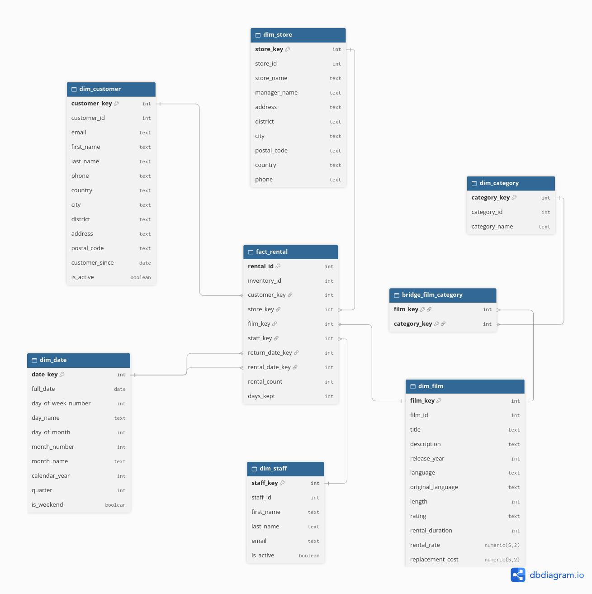

# Week 2: Rental Star Schema

This is the design for a star schema built on the rental data. It has one fact table, `fact_rental`, six dimension tables, and one bridge table that links films to categories. The tables will be built in Week 3.

- [rental-star-schema.dbml](rental-star-schema.dbml): the schema source. Paste it into [dbdiagram.io](https://dbdiagram.io/d/Dimensional_model_diagram-6afb41afd4a729077d0261a3) to edit the diagram.
- [rental-star-schema.png](rental-star-schema.png): the exported diagram.

## Grain

**One row in `fact_rental` is one rental of one inventory copy of a film by one customer.** The table must have **51,805 rows**.

## Tables

| Table | Type | Rows | What it holds |
| --- | --- | --- | --- |
| `fact_rental` | Fact | 51,805 | One row per rental, with keys to every dimension plus `rental_count` and `days_kept`. |
| `dim_customer` | Dimension | 999 | Customer name, contact details, address, `customer_since` and `is_active`. |
| `dim_film` | Dimension | 1,000 | Title, description, release year, language, length, rating, rental terms and replacement cost. |
| `dim_store` | Dimension | 500 | Store name, manager, address and phone. |
| `dim_staff` | Dimension | 1,500 | Staff name, email and `is_active`. |
| `dim_date` | Dimension | One per day | Calendar attributes: day, month, quarter, year and `is_weekend`. |
| `dim_category` | Dimension | 16 | Category names. |
| `bridge_film_category` | Bridge | 2,367 | Film-category pairs, because a film can have more than one category. |

## Relationships

| From | To | Notes |
| --- | --- | --- |
| `fact_rental.customer_key` | `dim_customer.customer_key` | |
| `fact_rental.film_key` | `dim_film.film_key` | |
| `fact_rental.store_key` | `dim_store.store_key` | The store that owns the copy, found through `inventory`. |
| `fact_rental.staff_key` | `dim_staff.staff_key` | |
| `fact_rental.rental_date_key` | `dim_date.date_key` | `dim_date` is used twice, as a role-playing dimension. |
| `fact_rental.return_date_key` | `dim_date.date_key` | Open rentals point to the `-1` row. |
| `bridge_film_category.film_key` | `dim_film.film_key` | Many-to-many link from films to categories. |
| `bridge_film_category.category_key` | `dim_category.category_key` | |

## Measures

| Measure | Meaning | Additive? |
| --- | --- | --- |
| `rental_count` | Always `1`. Sum it to count rentals. | Yes |
| `days_kept` | Return date minus rental date, in whole days. It is empty for open rentals. | Yes |

Payment amounts are **not** in this fact table. Payments will get their own fact table, with one row per payment.

## Design decisions

- **Readable date keys.** `date_key` is an integer such as `20220524`. `dim_date` has one row for every day, including days with no rentals.
- **Open rentals.** 241 rentals have no return date. Their `return_date_key` points to a special `-1` row labelled *Not returned yet*, and `days_kept` is empty.
- **Categories go through a bridge table.** A film can have several categories, so category totals add up to more than the total number of rentals.
- **Store name.** `store_name` is `store_id` plus the city, because 126 cities have more than one store. The manager comes from `store.manager_staff_id`.
- **Columns left out on purpose:** customer `uuid`, staff password, picture and username, and film actors, because a film can have many actors.
- **Blanks.** A blank store phone or film `original_language` is stored as *Not specified*.
- **Customers who never rented** (2 of them) are still kept in `dim_customer`.

## Data quality notes

- 749 rentals have no payment.
- Rental 4591 has six payments, and five of them belong to other customers.
- **Rule:** the customer on a payment must match the customer on its rental. Rental 4591 breaks this rule.
- Only stores 1 and 2 and staff 1 and 2 appear in rentals, even though the dimensions have 500 stores and 1,500 staff.

## Open questions

The SCD type for each of these changing attributes will be decided on Tuesday:

| Dimension | Attributes that can change |
| --- | --- |
| `dim_customer` | Address, phone, email, active status |
| `dim_film` | Rental rate, replacement cost |
| `dim_store` | Manager, phone |
| `dim_staff` | Email, active status |
